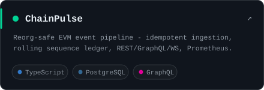
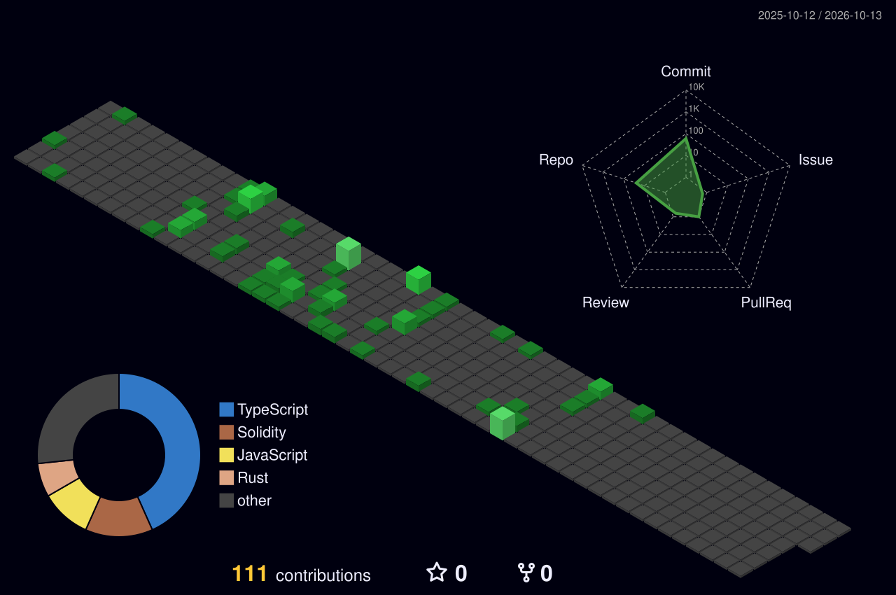

  

  

  <samp>
    <a href="mailto:anandsingh887472@gmail.com">email</a> &nbsp;·&nbsp;
    <a href="https://linkedin.com/in/anand-pratap707">linkedin</a> &nbsp;·&nbsp;
    
  </samp>

## <samp>$ whoami</samp>

I'm a **full-stack engineer** who builds **backend-heavy web products and AI-powered services**: TypeScript and Node.js APIs over **Postgres and Redis**, with **Next.js and React** on the front end. I care about the parts that break under real traffic: idempotency, ledgers that always balance, background jobs, caching and tests.

Lately I'm building with **LLMs** (embeddings, vector search, semantic caching) and sharpening **LLD/HLD in Java** for system design. I've also shipped Solidity/EVM work on an open-source payments protocol.

## <samp>$ cat ~/flagship</samp>

### [PayFlow](https://github.com/anandsingh07/payment-flow): a Razorpay-style payment gateway

- **Payments:** card + UPI with multi-provider failover and Thompson-sampling smart routing
- **Money correctness:** double-entry ledger in Postgres, idempotent APIs, fraud/risk engine
- **Merchant features:** payment links with hosted checkout, nightly settlements, HMAC-signed webhooks via a transactional outbox
- **Dashboard:** Next.js 16 with live updates over Server-Sent Events
- **Proof:** ~710 transfers/sec at 0% errors (k6, single Node.js process) · 125 automated tests (Vitest + Playwright E2E) · GitHub Actions CI · Docker

Payment providers are simulated sandboxes; no real money moves.

## <samp>$ ls ~/building</samp>

<table>
  <tr>
    <td>
      
    </td>
    <td>
      
    </td>
  </tr>
  <tr>
    <td>
      
    </td>
    <td>
      
    </td>
  </tr>
</table>

Also: **[WriteSpace](https://github.com/anandsingh07/blogApp)**, a full-stack blogging platform (Next.js 16, Prisma, Postgres) · [live](https://blog-app-eta-beige.vercel.app)

## <samp>$ cat ~/stack</samp>

  

## <samp>$ git log --graph</samp>

  

  
  

  

---

  <samp>$ echo "build systems that hold up &mdash; web2 + AI first, web3 when it earns it"</samp>

